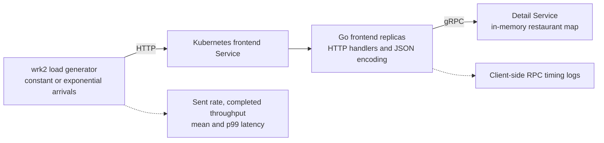

# Welp Microservice Performance Analysis

A Go and Kubernetes performance study of a restaurant-detail service, completed for UC San Diego CSE 190. The experiments compare constant and exponential request arrivals, use gRPC latency logs to investigate a bottleneck, and measure how frontend replication changes tail latency.

**Start with the [experiment write-up](docs/writeup.md) or [original four-page report](reports/lab2-analysis.pdf).** The original experiments ran on GCP. This repository showcases the available Lab 2 code and documents the collection workflow; its historical findings come from the attached report.

## Architecture



The workload issues approximately **80% reads and 20% writes**. Writes update existing restaurant records. Each service process preserves the course baseline's `GOMAXPROCS(1)` setting, and the detail service protects its map with a mutex.

## Findings from the original report

- At a reported load of **9,400 requests/s**, the latency plotted as p99 was **139.22 ms for constant arrivals** and **933.57 ms for exponential arrivals**. Bursty arrivals reached the 500 ms latency target earlier.
- At **12,800 requests/s**, increasing run duration increased end-to-end tail latency while measured backend RPC latencies remained comparatively stable. The team identified the frontend path as the likely bottleneck.
- Adding a second frontend replica shifted the reported 500 ms boundary to approximately **16,000 requests/s for constant arrivals** and **15,600 requests/s for exponential arrivals**. Further scaling showed diminishing returns.
- Optimization experiments reported lower average latency from the connection-related variant, little benefit from the map variant, and worse tail latency from the JSON-library variant. The report says proxy overhead outweighed its benefits in the tested setup.

These are report findings, not measurements generated by this repository. The write-up explains metric ambiguities and limits on causal conclusions.

## Reading guide

| Material | Contents |
| --- | --- |
| [Original report](reports/lab2-analysis.pdf) | Submitted analysis, figures, and optimization discussion |
| [Write-up](docs/writeup.md) | Research questions, results, queueing interpretation, and limitations |
| [Experiment workflow](docs/experiment-methodology.md) | GCP environment, deployment, workload commands, log collection, and plotting |
| [Source notes](docs/source-notes.md) | Provenance and changes made to isolate Lab 2 |
| [Assignment reference](docs/reference/lab2-assignment.md) | Original Lab 2 tutorial and requirements |
| [Report summary data](results/report-summary.csv) | Eight numerical points transcribed from page 1 |

## Source layout

```text
cmd/                 frontend/detail entry point
services/            HTTP frontend, gRPC detail service, RPC timing interceptor
proto/detail/        Protobuf definition and generated Go bindings
manifests/           frontend/detail Kubernetes topology
workloads/lab2/      Lua workload definitions
samples/             restaurant records used by the workload
wrk2/                course-customized load generator, including -D const/exp
scripts/             seeding, collection, parsing, and plotting helpers
docs/                write-up and experiment documentation
reports/             original PDF report
results/             report-derived aggregate table and data-format notes
tests/               parser checks with explicitly synthetic fixtures
```

## Build and inspect

With Go 1.23 or later:

```bash
make build
make check
```

The binary supports `frontend` and `detail` roles. The [experiment workflow](docs/experiment-methodology.md) describes commands for a provisioned Linux GCP VM. No GCP provisioning or benchmark execution is part of the local checks.

Only the frontend/detail path exercised by Lab 2 is included. Review, reservation, caching, and storage labs are outside this project's scope. The historical optimization variants and Istio configuration were not supplied, so their implementations are not reconstructed as if they were original code.

## Credits

Original report: **Chris Kim, Jared Jose, and Ziyue Liu (Tim Liu)**. The baseline application, workload, and customized load generator originate from [UCSD CSE 190 course materials](https://github.com/ucsd-cse190-wi25/cse190-labs).

See [THIRD_PARTY_NOTICES.md](THIRD_PARTY_NOTICES.md) for source attribution and retained third-party license files.
